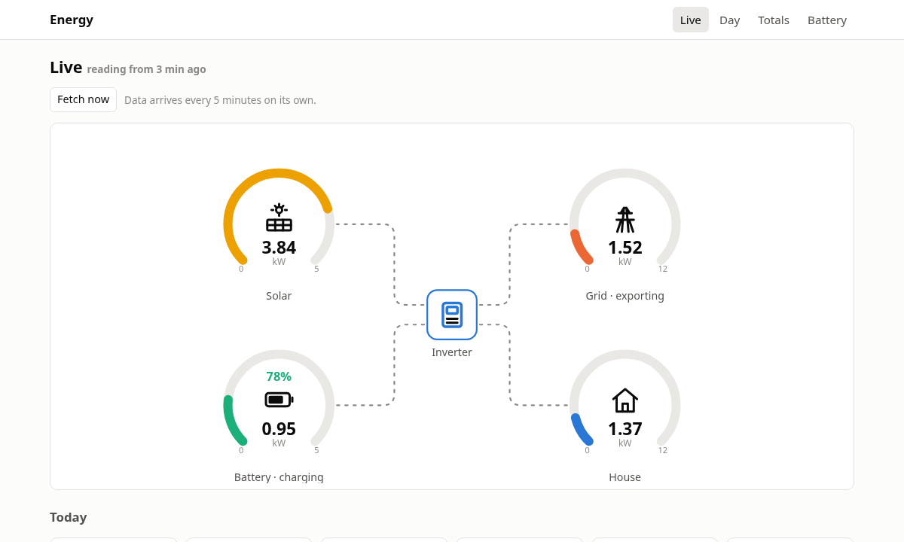
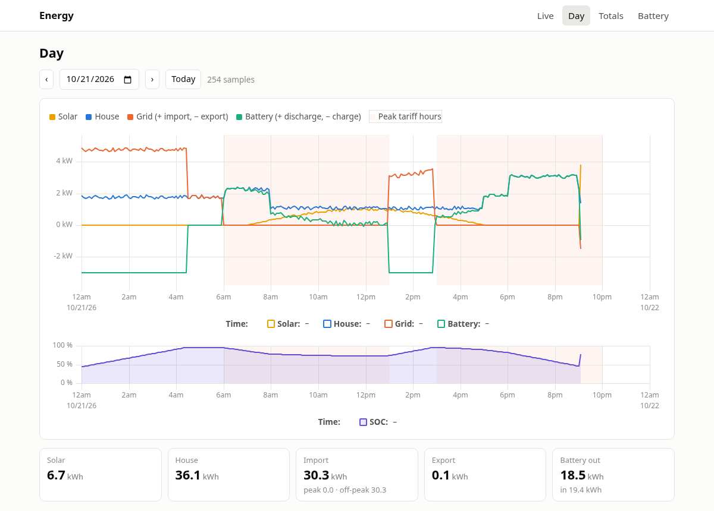
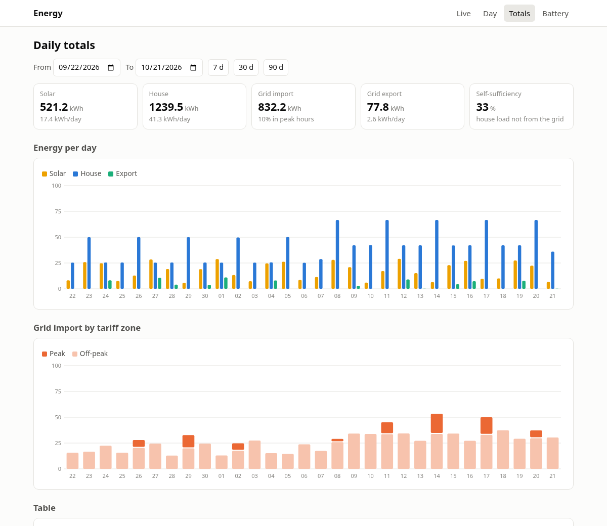
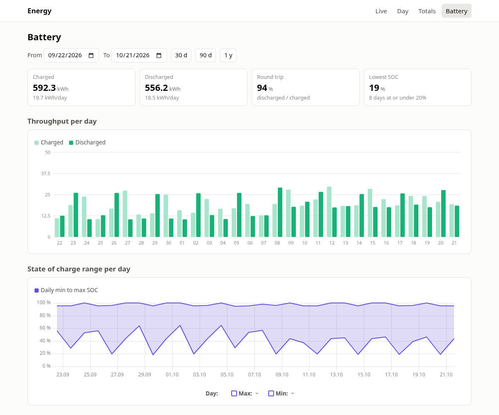
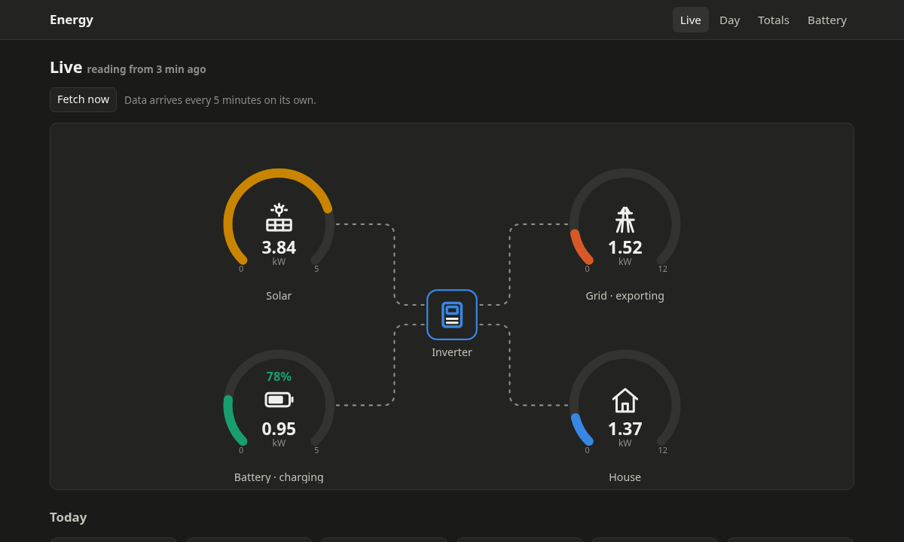

# Deye Cloud browser

A small, self-hosted energy dashboard for Deye hybrid inverters. A Cloudflare Worker pulls 5 minute history from the Deye Cloud OpenAPI, keeps it in a D1 database for as long as you like, and serves a few static pages: a live power flow, a day chart with tariff zones, daily totals split by tariff zone, and battery throughput. It is read-only against Deye and never changes inverter settings.

[](https://deploy.workers.cloudflare.com/?url=https://github.com/crustovsky/deyecloud-browser)



- **Live**: four gauges (solar, grid, battery, house) with animated flow wires, in the style of the inverter's own panel, today's totals and a Fetch now button
- **Day**: PV, house, grid and battery power for any day, state of charge underneath, peak tariff hours shaded
- **Totals**: energy per day, grid import split into peak and off-peak hours, self-sufficiency, and a table with every number
- **Battery**: daily charge and discharge, round trip, lowest state of charge per day
- Private by default: only visitors authenticated by [Cloudflare Access](https://developers.cloudflare.com/workers/configuration/cloudflare-access/) see anything
- Light and dark mode, works on a phone
- Fits in the free tiers of Workers and D1; about 9,000 Deye API calls a month

<details>
<summary>More screenshots</summary>









</details>

## Before you deploy

1. Create a developer application at [developer.deyecloud.com](https://developer.deyecloud.com) and note its **App ID** and **App Secret**. It needs station monitoring; device monitoring does no harm; it needs no control permissions.
2. Have your Deye Cloud account email and password ready. The Worker hashes the password with SHA-256 before sending it, as the API requires.
3. Find your region's API host. EU accounts use `https://eu1-developer.deyecloud.com`.

## Deploy

### With the Deploy to Cloudflare button

The button forks this repository into your GitHub or GitLab account, creates the D1 database, builds the site and deploys the Worker to a `*.workers.dev` address. Every push to the new repository redeploys it. On the setup screen, set the variables listed under [Configuration](#configuration); the defaults suit a Polish G12 tariff.

After the deploy:

1. Add the four secrets under the Worker's **Settings → Variables and Secrets**: `DEYE_APP_ID`, `DEYE_APP_SECRET`, `DEYE_EMAIL`, `DEYE_PASSWORD`.
2. [Turn on Cloudflare Access](#turn-on-cloudflare-access). Until you do, the Worker only shows a "This dashboard is private" page.
3. Wait for the cron, which runs every 5 minutes. The first runs backfill history from `BACKFILL_FROM` at six days per run; the footer shows progress.

### Manually

```sh
git clone https://github.com/crustovsky/deyecloud-browser && cd deyecloud-browser
npm install
npx wrangler login
cp wrangler.jsonc wrangler.local.jsonc       # your copy, ignored by git
npx wrangler d1 create deyecloud-browser     # paste the database_id into wrangler.local.jsonc
npm run wrangler secret put DEYE_APP_ID
npm run wrangler secret put DEYE_APP_SECRET
npm run wrangler secret put DEYE_EMAIL
npm run wrangler secret put DEYE_PASSWORD
npm run deploy
```

`wrangler.local.jsonc` is where your own settings go: the database id, `SITE_TITLE`, `BACKFILL_FROM`, a custom domain, `workers_dev: false`, anything. Every npm script uses it when it exists and falls back to the committed `wrangler.jsonc` otherwise, so your values never have to be pushed. `npm run wrangler <args>` runs any wrangler command against the same file.

The Worker creates its tables on first use; there is no migration step.

## Turn on Cloudflare Access

1. In the dashboard go to **Workers & Pages** and select the Worker.
2. Open the **Access** tab and select **Protect this Worker behind Access**.
3. Change the scope to **All traffic**. The default, **Previews only**, leaves the main address unprotected.
4. Under **Authentication policy**, choose who may sign in: your Cloudflare account members, specific emails, or an email domain.
5. Select **Apply Access**.

This protects every address the Worker answers on. A custom domain can be added in the Worker's **Domains** tab. If you really want a public dashboard, set `ALLOW_PUBLIC` to `true`.

## Configuration

Variables in `wrangler.jsonc`, in your `wrangler.local.jsonc`, or on the Worker's **Settings → Variables** page:

| Variable           | Default                               | Meaning |
| ------------------ | ------------------------------------- | ------- |
| `ALLOW_PUBLIC`     | `false`                               | `true` serves visitors without Cloudflare Access. |
| `SITE_TITLE`       | (empty)                               | Name in the top bar. Empty uses the plant name from Deye Cloud. |
| `DEYE_BASE_URL`    | `https://eu1-developer.deyecloud.com` | OpenAPI host for your region. |
| `DEYE_POWER_UNIT`  | `W`                                   | Unit of power values from the API, `W` or `kW`. If PV reads 1000x off, flip it and re-run the backfill (see below). |
| `STATION_NAME`     | (empty)                               | Plant name, only if the account has several. Empty picks the first. |
| `BACKFILL_FROM`    | (empty)                               | First day of history to fetch, `YYYY-MM-DD`. Empty means the last 30 days. |
| `TIMEZONE`         | `Europe/Warsaw`                       | IANA timezone of the plant. Day boundaries and tariff zones follow it. |
| `OFFPEAK_HOURS`    | `22-6,13-15`                          | Cheap tariff hours in local time, `start-end` ranges separated by commas, ranges may wrap midnight. Empty means a flat tariff (everything counts as peak). |
| `GAUGE_PV_KW`      | `5`                                   | Full scale of the solar gauge, usually the array size in kWp. |
| `GAUGE_GRID_KW`    | `12`                                  | Full scale of the grid gauge. |
| `GAUGE_BATTERY_KW` | `5`                                   | Full scale of the battery gauge. |
| `GAUGE_LOAD_KW`    | `12`                                  | Full scale of the house gauge. |

Secrets: `DEYE_APP_ID`, `DEYE_APP_SECRET`, `DEYE_EMAIL`, `DEYE_PASSWORD`. They live on the deployed Worker (`wrangler secret put` or the dashboard). The same four names in a local `.dev.vars` file serve only `npm run dev` and `npm run probe` on your machine and are never uploaded.

### Checking units and signs

Deye's API documentation does not state units or sign conventions. Before trusting the totals, run the probe once from your machine:

```sh
cp .dev.vars.example .dev.vars    # fill in the four secrets (or export them in your shell)
npm run probe
```

It makes four read-only API calls and prints the raw station list, latest data and a few history frames, with notes on what to look for. The dashboard uses: grid positive = import, battery positive = discharging, matching the Deye web export.

On the inverters checked so far the API returns watts, `batteryPower` signed (negative while charging), and only the grid magnitude: `gridPower` is null and `purchasePower` equals `wirePower` in every frame. The Worker therefore takes the grid direction from the power balance (house load minus PV minus battery), which is exact apart from the inverter's own losses of around 100 W.

After changing `DEYE_POWER_UNIT` or `BACKFILL_FROM`, delete the cursor to fetch again:

```sh
npx wrangler d1 execute deyecloud-browser --remote --command "DELETE FROM meta WHERE key = 'cursor'"
```

After changing `OFFPEAK_HOURS` or `TIMEZONE`, recompute the totals from the stored readings instead; no API calls needed:

```sh
curl -X POST "https://<your worker>/api/rollup?from=2026-01-01&to=2026-12-31"
```

(Through Access you need a [service token](https://developers.cloudflare.com/cloudflare-one/identity/service-tokens/) or a browser session; the simplest way is the browser's developer console on the dashboard.) Rows are overwritten in place, so nothing is ever duplicated.

## How it works

```
Deye Cloud OpenAPI  <--  Worker (cron every 5 min)  -->  D1 (readings, daily, meta)
                                   |
                   static Astro pages + /api/* on one hostname, behind Access
```

**Ingest.** One function serves the cron, the Fetch now button and the initial backfill. A cursor in the `meta` table records how far history has been fetched. Each run asks `station/history/power` for the window from 15 minutes before the cursor (so late-filled frames are caught) to at most one day ahead, upserts the frames on their timestamp, moves the cursor and repeats a few times. An empty database starts the cursor at `BACKFILL_FROM`. The same loop therefore handles the first fill, catching up after an outage and the normal 5 minute increment.

**Daily totals.** Energy is integrated in the Worker from the 5 minute samples: kW × gap to the next sample, with gaps capped at 10 minutes so outages do not inflate totals. Each sample's tariff zone comes from its local hour in `TIMEZONE`, so daylight saving changes are handled. Totals are recomputed for every day a run touched.

**Rate limits.** On HTTP 429 or 5xx the run stops, honours `Retry-After` or backs off exponentially up to 30 minutes, and the next cron resumes. The Worker counts API calls per day and keeps any rate limit headers it sees; both show at `/api/status`. Deye's preliminary policy is 100,000 calls a month and 60 a minute; the 5 minute cron uses about 9,000.

**Deye API notes**, verified against the Swagger spec at `https://eu1-developer.deyecloud.com/v2/api-docs`:

- Every endpoint is a POST with a JSON body and a `Bearer` token. Tokens last about 60 days and are cached in D1.
- Errors arrive as HTTP 200 with `{ "success": false, "code": "...", "msg": "..." }`, so the client checks `success` on every response.
- `station/history/power` takes unix second timestamps, allows up to 12 months per call, and returns 5 minute frames with generation, consumption, grid, purchase, wire (feed-in), battery, charge, discharge and SOC fields.
- The spec does not state units, sign conventions or the timestamp format, hence the probe script. Observed: watts, unix seconds, signed `batteryPower`, grid magnitude only (see above). The client also accepts kW, milliseconds, date strings and a signed `gridPower` should another firmware send them.

**Pages.** The Astro build is embedded in the Worker bundle rather than served through Workers static assets. Workers with static assets run behind a router that does not pass the Access identity to the Worker, which would defeat the private-by-default check. The whole site is about 100 KB, so shipping it inside the Worker costs nothing.

**API** (same origin, behind Access): `GET /api/config`, `GET /api/status`, `GET /api/latest`, `GET /api/day?date=YYYY-MM-DD`, `GET /api/daily?from=&to=`, `POST /api/ingest?chunks=` (at most once a minute), `POST /api/rollup?from=&to=`.

**Storage.** Three D1 tables: `readings` (one row per 5 minute frame: ts, pv_kw, load_kw, grid_kw, battery_kw, soc), `daily` (per local day: energy totals, import split by zone, SOC range, sample count), `meta` (cursor, token, station, last run, counters). A year of readings is about 105,000 rows, far inside the free D1 tier.

## Local development

```sh
npm install
cp .dev.vars.example .dev.vars    # fill in the secrets
npm run dev                       # builds the site, then wrangler dev with a local D1
```

The dashboard is then at `http://localhost:8787`. `wrangler dev` uses a local, empty database; `curl -X POST "localhost:8787/api/ingest?chunks=30"` fills it. The `access.dev` block in `wrangler.jsonc` simulates a signed-in Access user; remove it to see what an unauthenticated visitor gets.

`npm test` runs unit tests for tariff zone assignment, day boundaries across daylight saving changes and the energy integration. `npm run check` type-checks the site and the Worker.

### Project layout

```
worker/      Cloudflare Worker: Access gate, cron, Deye client, ingest, rollups, JSON API
site/        Astro pages, components and client-side chart code (uPlot and a small SVG bar chart)
test/        vitest unit tests
scripts/     probe.mjs, the one-off raw API dump
docs/        screenshots
```

## Limits

- Data freshness is bounded by the logger, which uploads every 5 minutes, and by Deye's server-side cache of plant data, also about 5 minutes. Fetch now cannot beat that.
- Only plant-level data is stored. Per-device detail (phase voltages, temperatures) is available from the API but not used.
- Totals are integrated from power samples, so they drift slightly from the inverter's own energy counters. Expect agreement within a few percent.

## License

[MIT](LICENSE)
